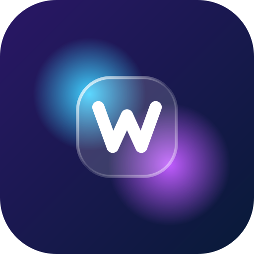

<div align="center">



# WClip

**Нарезка записей Twitch с чатом в кадре: ссылка, тайминги, готовые MP4.**


</div>

> [!WARNING]
> **Проект в бета-тесте.** Функциональность собирается по частям, многое ещё не работает или будет меняться.
> Сборки — в [Releases](https://github.com/WahhaWood/wclip/releases).
> Нашли ошибку — откройте [issue](https://github.com/WahhaWood/wclip/issues).

## Что это

Укажите ссылку на запись стрима и интервалы, а WClip вырежет их и наложит чат стрима поверх видео.

- Один файл без установки: `.exe` для Windows, AppImage для Linux.
- Публичные записи открываются без входа в аккаунт; записи для подписчиков — с токеном Twitch из браузера.
- Неопубликованное видео можно взять файлом с диска (запись OBS, повтор), а чат — из лога Chatterino или JSON TwitchDownloader.
- Поиск моментов: график активности чата всей записи, всплески с частыми словами, поиск по чату, кадр по клику.
- Подгонка начала и конца интервала по кадрам.
- Чат со смайлами Twitch, 7TV, BTTV и FFZ (анимированные двигаются), бейджами и цветами ников; боты и команды скрываются.
- Настраиваемый оверлей: положение, размер, шрифт, прозрачность, подложка под сообщениями, время жизни сообщений; пресеты.
- Чат в кадре или отдельным видео с прозрачностью для монтажа.
- Вертикальные клипы 9:16 для Shorts, TikTok и Reels: камера и игра из разных частей кадра, размытый фон, чат; раскладка запоминается для канала.
- Кодирование на видеокарте (NVENC, Quick Sync, AMF, VAAPI) или процессоре, H.264 или H.265; склейка клипов в один ролик.
- ffmpeg и yt-dlp докачиваются при первом запуске (или берутся из `PATH`).
- Обновление программы по кнопке, с проверкой SHA-256.

## Как работает

1. yt-dlp находит поток записи (HLS).
2. Комментарии чата загружаются за нужный интервал (или за всю запись, параллельно, чтобы искать моменты; чат всей записи сохраняется на диске до следующего открытия).
3. ffmpeg читает из потока только этот интервал, с точностью до кадра, накладывает чат и кодирует в H.264/H.265 + AAC за один проход. Временных файлов нет.

Архитектурные решения описаны в [docs/adr](docs/adr), термины — в [GLOSSARY.md](GLOSSARY.md).

## Сборка из исходников

Нужны Rust (stable), Node.js 22 и [системные зависимости Tauri 2](https://v2.tauri.app/start/prerequisites/).

```sh
npm ci
npm run tauri dev     # запуск в режиме разработки
npm run tauri build   # релизная сборка
```

## Стек

[Tauri 2](https://tauri.app) + Rust, интерфейс на Svelte 5 + TypeScript.

## Лицензия

[MIT](LICENSE).

WClip — неофициальный инструмент и не связан с Twitch. Скачивайте и публикуйте только то, на что у вас есть права.
